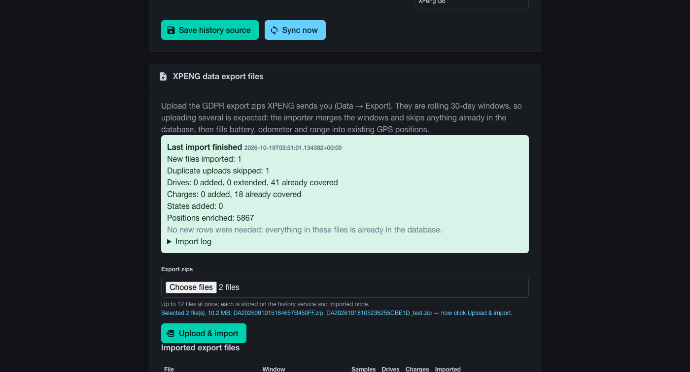
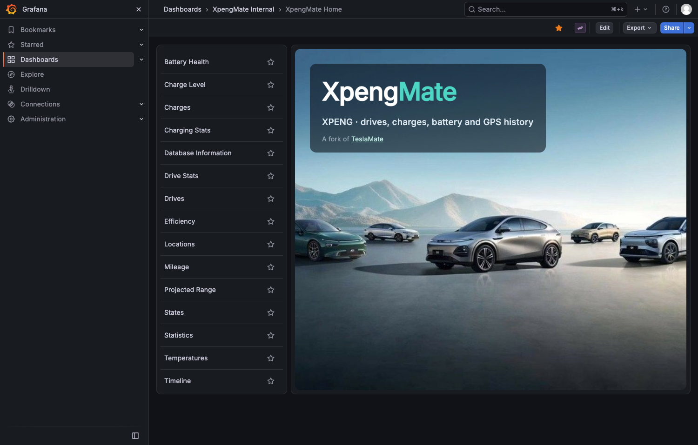

# XpengMate

A self-hosted data logger for an **XPENG**, built on
[TeslaMate](https://github.com/teslamate-org/teslamate) and augmented with the
car's history from [EVConduit](https://evconduit.com).

TeslaMate's app, database schema, web UI and Grafana dashboards are kept; what
changes is where the data comes from:

* a small **XPeng engine** (Python) authenticates to XPENG's cloud, holds the
  mTLS MQTT telemetry stream open and serves it to the fork over TeslaMate's own
  "fleet provider" API - the same interface TeslaMate uses for a Tesla;
* a **history importer** backfills drives, charging sessions, GPS positions and
  states that were recorded before XpengMate existed.

Nothing about the car is invented: a field the XPENG platform does not report is
stored as `NULL`, not as zero.

## Architecture

```
XPENG cloud (mTLS MQTT + REST)          EVConduit history (Postgres/PostgREST)
            |                                        |
            v                                        v
   engine: auth + telemetry              history: trips, charges, GPS, states
   Tesla provider API (:8201)            one-shot importer
            |  HTTP, TOKEN                          | SQL
            +----------------+----------------------+
                             v
                  xpengmate (TeslaMate fork) :4100
                             |
                +------------+------------+
                v                         v
          Grafana :3003             MQTT -> Home Assistant
```

Details, including the provider contract and the one schema concession, are in
[docs/ARCHITECTURE.md](docs/ARCHITECTURE.md).

## Quick start

```bash
git clone https://github.com/xpengtoolkit/xpengmate
cd xpengmate
cp .env.example .env
chmod 600 .env
# fill in the secrets: ENCRYPTION_KEY (openssl rand -hex 32), DATABASE_PASS,
# GRAFANA_ADMIN_PASSWORD, XPENG_PROVIDER_TOKEN (openssl rand -hex 24),
# RELEASE_COOKIE (openssl rand -hex 24)
mkdir -p data/engine/{certs,secrets,state}

# BuildKit is required: the Dockerfiles use COPY --chmod.
DOCKER_BUILDKIT=1 docker-compose build
docker-compose up -d
docker-compose ps
```

Open `http://<host>:4100`. The sign-in screen shows the provider token path; the
button calls the engine's `/oauth2/v3/token` and starts the logger. From a shell:

```bash
docker exec xpengmate_xpengmate_1 \
  bin/teslamate rpc 'IO.inspect(TeslaMate.Api.sign_in(%TeslaMate.Auth.Tokens{}))'
```

The car reports `offline` until the engine has XPENG credentials (next section)
- or until the history importer has written data (the UI then shows the imported
history immediately).

Health checks:

```bash
curl http://localhost:8201/healthz      # engine: {"ok": true, ...}
curl -I http://localhost:4100/          # app: 200 once signed in, 302 before
./scripts/smoke-test.sh                 # the above, with assertions
```

## Settings in the app


`/xpengmate` in the web UI is the configuration page. Everything it changes is
applied by restarting the engine (a few seconds):

* **Live source** — choose the xpengtoolkit 0.6.16 provider (recommended), the
  Home Assistant entity fallback, or the native XPENG cloud engine. Provider URL
  and token are entered here, and "Test source" probes them before saving.
* **XPENG credentials** — upload the three app-tier PEMs, the tenant key pool and
  the token pair. They are written mode 0600 on the engine's volume, never shown
  back, and the source switches to the native engine.
* **History from EVConduit** — configure the source, run "Sync now", and read
  how old the data is: row counts per table, newest row per table, and the lag
  between XPengMate's database and the EVConduit source.

  | Who you are | What to enter | What you get |
  |---|---|---|
  | Normal EVConduit account | **API base URL + your xpengcardata API key** (EVConduit → History → API) | the newest 200 trips and charging sessions, with each trip's GPS track; a rolling recent window, not a backfill |
  | Someone self-hosting EVConduit | the EVConduit Supabase URL + **service-role key** | the complete history (this is the operator credential, not something a normal user has) |
  | No EVConduit at all | leave history unconfigured | live logging plus your XPENG export-file imports; no historical GPS before live logging started |

  The service-role key bypasses row-level security; it is read-only here but
  should be treated like a password and rotated/scoped if the host is shared.

## Live data: three ways

The engine can be the XPENG client itself, or it can read live telemetry from an
XPENG Home Assistant integration. XPENG allows **one session per account**, so
these are alternatives, not layers:

```yaml
# native: the engine authenticates to XPENG itself
XPENG_SOURCE=xpeng
# certs/, secrets/ mounted as below

# or: read the live entities of an xpengtoolkit integration over HA's API
XPENG_SOURCE=ha
XPENG_HA_URL=http://homeassistant.local:8123
XPENG_HA_TOKEN=<long-lived token, read-only use>
XPENG_HA_ENTITY_PREFIX=xpeng_800783
```

The **provider** source is a relay: the engine forwards TeslaMate's four read
routes and the streaming websocket to the integration's own provider (xpengtoolkit
0.6.16+), swapping in the integration's token. The integration owns the XPENG
session and everything else, and XPengMate still exposes one stable local endpoint
to the app.

The **HA entities** source is the older fallback: it subscribes to `state_changed`
over HA's websocket, reconstructs the same telemetry tree, and takes the car's own
timestamp from `last_data_update`. It is what to use when the provider option is
not enabled.

## XPENG credentials for the engine

The engine reads three files from `data/engine/`:

| Path | What it is |
|---|---|
| `certs/ca-chain.crt`, `certs/client-cert-0.pem`, `certs/client-key.pem` | the app-tier mTLS identity, extracted from an XPENG APK 3.7.0-3.12.0 |
| `secrets/xpeng_tenant.json` | the tenant key pool, sealed with this install's device id |
| `secrets/xpeng_tokens.json` | the account's access/refresh token pair |

All three come from the [xpengtoolkit](https://github.com/xpengtoolkit/xpengtoolkit)
project; its README and `docs/UNATTENDED_RENEWAL.md` are the authority on
producing them.

> **One session per XPENG account.** XPENG allows a single live session per
> account, so the engine must not share an account with another host that is
> also connected. Use a dedicated account for XpengMate (share the car to it from
> your primary account). Two clients on one account evict each other in a loop.

Set `XPENG_ALLOW_OFFLINE=false` once the files exist, so a missing credential is
a startup failure rather than a car that quietly never logs.

The engine's device identity is fixed by the tenant file's `deviceId` and is
never regenerated: the token pair is sealed against it.

## Importing XPENG data exports



XPENG's GDPR data exports are rolling 30-day windows, so the useful workflow is
"upload a handful of them". The **XPENG data export files** card on
`/xpengmate` accepts up to 12 zips at once, posts them as a normal multipart
form (reliable for large selections; the native file input and a line under it
show exactly which files are selected), and redirects back with an explicit
confirmation: the card then reports "new files imported", "duplicate uploads
skipped", added/extended/covered rows, and says outright when nothing new was
needed. It imports into the database:

* each zip is parsed for drives (speed-integrated distance, odometer, SoC
  bounds, peak power), charging sessions (energy drawn at the wall and into the
  pack, SoC and range bounds), hourly tyre pressures and online/asleep spans;
* overlapping windows are merged — a drive cut at a window edge is stitched, a
  drive described twice is kept once, and nothing is double counted;
* records already covered by richer sources (the live logger or EVConduit, both
  of which have GPS) are skipped, and a longer export version replaces a
  previously truncated one;
* the export's 1 Hz SoC/odometer/range is joined onto existing GPS positions;
* the rated-range delta of every drive/charge, the AC/DC split, the derived
  efficiency and the start/end addresses are filled by the backfill below - the
  energy, battery-health, charges and locations dashboards are built on them;
* files are remembered by content hash, so re-uploading the same zip is a no-op,
  and the card lists every imported file with its window and row counts.

Because the export has no GPS, an import can legitimately add **zero** rows when
the uploaded windows are already covered by the live logger or EVConduit - the
card says so instead of looking like a failure.

Deliberately not imported: positions. The export has no coordinates, and the
importer will not invent them.

## Filling TeslaMate's derived columns

`history/backfill_teslamate.py` completes the rows the import could not: drive
and charge rated ranges (from the exports, the positions table, or the SOC as a
last resort), `charger_phases` so AC/DC is not "everything DC", the rated range
on charge samples (battery capacity and cycles), `cars.efficiency` (km -> kWh),
`positions.drive_id`, and the start/end/charge addresses via Nominatim
(cached in `addresses`, 1 req/s, skipped with `--no-geocode`).

```bash
docker exec xpengmate_history_1 python backfill_teslamate.py
```

It reads every zip in the uploaded export directory and is idempotent, so run
it again after importing more exports. Import a spread of 30-day exports (they
overlap by design) so every period is covered by at least one zip.

## Outside temperature

The live source sets `climate_state.outside_temp` from a Home Assistant sensor
(configurable in `/xpengmate` as *Outside temperature entity*, default
`XPENG_OUTSIDE_TEMP_ENTITY`, e.g.
`sensor.xpeng_800783_weather_at_vehicle`). TeslaMate stores that value on each
position, so the drive/charge temperature averages and the
*Temperature - Driving Efficiency* panel follow the sensor rather than the
provider's own weather value.

## History import

One-shot, idempotent, safe to re-run:

```bash
docker-compose run --rm history
```

It reads the VIN's rows from EVConduit's `xpeng_trips`, `xpeng_charging_sessions`,
`vehicle_positions` and `xpeng_tyre_pressures` (read-only service-role access;
set `SUPABASE_URL` / `SUPABASE_SERVICE_ROLE_KEY` in `.env`), and writes:

* `drives` - distance, duration, max speed, odometer pair; elevation stays `NULL`
* `positions` - only real GPS points from the owner's logger, attached to drives
* `charging_processes` - both energies (into the pack, drawn at the wall), SoC
  bounds, duration
* `states` - `online` where there is evidence of activity, `asleep` across the
  gaps; `offline` is never invented

Every row it creates is recorded in `xpengmate_import`, so a re-run replaces its
own rows and never touches anything the live logger wrote.

Daily sync is installed as a user crontab entry (see
`ops/xpengmate-history.cron`; a systemd timer is beside it for hosts with root).
To also refresh the export zip that enriches positions with SoC and range:

```bash
EVCONDUIT_USER=<evconduit account id> ./scripts/sync-history.sh
```

That copies the newest export from the EVConduit host (where the zips live on
disk - the API cannot serve them without a user token) into `data/exports/`, then
runs the importer. Point `XPENG_EXPORT_ZIP` at the directory and the newest zip
is picked automatically.


## Grafana branding



The dashboards are TeslaMate's, rebranded: folder names, panel descriptions, the
Home dashboard and the datasource display name all say XpengMate, and the Home
background is the supplied XPENG line-up image with the XpengMate wordmark,
"XPENG · drives, charges, battery and GPS history" tagline and a "A fork of
TeslaMate" credit overlaid on top of it (shipped as a Grafana static asset at
`/public/img/xpengmate-hero.jpg`, referenced by a host-independent URL), and the
dashboard list back beside it. The
datasource **uid stays `TeslaMate`** because every provisioned panel references
it; only its display name changed.

## Verification status

Measured on the reference car (G6 RWD, VIN `…800783`):

| Check | Result |
|---|---|
| Engine provider contract (token, products, vehicle_data, websocket) | passes offline test suite |
| xpengmate sign-in through the engine | `Starting logger for 'XPENG 800783'` |
| History import (EVConduit, 2026-08-13 .. 2026-10-17) | 342 drives, 25,249 positions, 104 charges, 22,957 charge samples, 641 states |
| Export enrichment (positions with SoC/odometer/range) | 24,150 of 25,249 (95.6%) |
| Daily sync | user crontab installed on xpengmate-host, 03:30 |
| App pages / branding | `XpengMate` title, logo, charge pages render (incl. a charge with no GPS) |
| Live path end to end (`XPENG_SIMULATE` replay of a real 292 km drive + charge) | drive opened/closed at 292.31 km, charging process opened, 1,279 positions written |
| **Live car telemetry** (HA source, production integration on `.88`) | online state opened, position row written (59% / 62,142 km / GPS / TPMS), stream connected, XOS `5.9.5.8909` recorded in `updates` |
| Native XPENG cloud source | built and unit-tested; needs a dedicated account's certs/tenant/tokens |

## What is approximate

These follow from what XPENG exposes, not from how the fork is wired:

* **Live charge energy** is estimated from battery percentage x usable capacity;
  XPENG does not publish a session's kWh.
* **Outside temperature** is the weather at the car, not an ambient sensor.
* **Drive power** is `0` while driving (XPENG does not expose motor power to the
  integration); charging power is real and negative.
* **Elevation, ascent, descent** are not available live or historically.
* Fast-charging vs slow-charging is inferred from power.

## Repository layout

```
elixir/            TeslaMate, unchanged apart from branding and one nil guard
grafana/           TeslaMate's dashboards (24 provisioned)
engine/            the XPENG engine: auth, MQTT, Tesla provider API
history/           the EVConduit history importer
scripts/           deploy + smoke test
docker-compose.yml the whole stack
docs/              architecture
```

## Upstream, licence and attribution

XpengMate is a fork of [TeslaMate](https://github.com/teslamate-org/teslamate),
© the TeslaMate contributors, and stays under the **AGPL-3.0-or-later** (see
[LICENSE](LICENSE) and [NOTICE](NOTICE)); modified files are marked as modified
by this fork. "TeslaMate" is a trademark of its project; this fork uses it only
to describe its origin. XpengMate is not affiliated with XPENG.

The engine vendors code from [xpengtoolkit](https://github.com/xpengtoolkit/xpengtoolkit)
(also AGPL-3.0-or-later); see [engine/VENDOR.md](engine/VENDOR.md) for the exact
revision.
