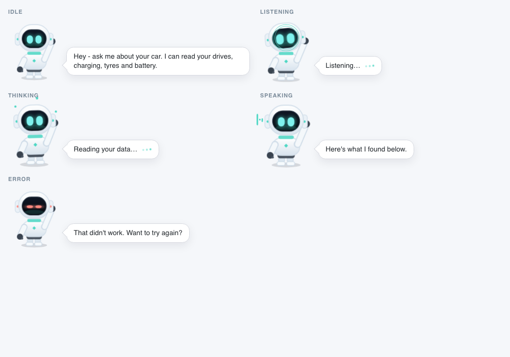

# Pengu — the Ask page's companion mascot

Handover notes for the little robot on XpengMate's `/ask` page, written so the
component can be lifted into another project without reading the rest of this
repo. It covers what it is, the contract it exposes, the files to copy, and the
gotchas that cost real time the first time round.

The same pattern works for any assistant UI: a chat page, a voice assistant, a
support bot. Nothing here depends on Phoenix, LiveView or Bulma; the core is one
state attribute, a stylesheet, and the artwork.

There are **two renderings of the same thing**:

* the **default** one uses artwork generated by image/video models through
  OpenRouter — a 3D-rendered robot with an animated idle loop, shown in a small
  "display" frame (see §2);
* the **fallback** is the hand-drawn inline SVG, which needs no assets at all
  and is what a checkout without the generated files renders.



*Rendered with the states harness in §10 — five wrappers, one stylesheet, no
application running. This is the generated artwork; the SVG fallback is at the
bottom of this page.*

---

## 1. What it is

A small robot that sits next to the composer and shows, at a glance, what the
assistant is doing:

| Mood | Trigger | What the reader sees |
|---|---|---|
| `idle` | page load, or nothing happening | the animated loop breathes, blinks and waves; a hint bubble on the first visit |
| `listening` | the user starts typing | leans in and cups a hand to its head pod (artwork) / eyes widen with rings (SVG) |
| `thinking` | question submitted, tools running | hand to its chin, the bubble shows the live progress label |
| `speaking` | the answer arrives | gestures with both hands and bobs, "Here's what I found" |
| `error` | provider or tool failure | shrugs and shakes, thin worried eyes, red accents |

The **artwork** rendering uses one image per mood plus an animated idle loop (see
§2); the **SVG** fallback expresses the same moods with vector overlays (ripples,
orbit dots, an equaliser in the visor).

After `speaking` or `error` it settles back to `idle` after a few seconds.

It is **decoration with a job**: it carries no information that is not also in
real text, so it is `aria-hidden` and the page keeps its normal progress and
status elements for assistive tech.

## 2. The generated artwork

The default mascot is not drawn by hand. `scripts/pengu-art.py` regenerates the
whole set through **OpenRouter**, and the outputs are committed under
`elixir/priv/static/images/pengu/`:

| File | Size | What it is |
|---|---|---|
| `idle.png` | ~1.1 MB | Animated PNG (APNG), 10 fps, seamless 4.8 s boomerang of the robot breathing/swaying/waving — the "alive" idle state |
| `idle-still.png` | ~45 kB | First frame as a still, for `prefers-reduced-motion` (CSS cannot stop an APNG) |
| `listening.png` | ~120 kB | Transparent PNG: hand cupped to the head pod |
| `thinking.png` | ~115 kB | Hand to the chin, eyes narrowed |
| `speaking.png` | ~120 kB | Both hands open, mid-sentence |
| `error.png` | ~115 kB | Shrug, thin worried eyes |

Cost of generating the set: about **US$0.22** — an image model for the
character and poses, a video model for the idle loop.

### The pipeline (`scripts/pengu-art.py`)

1. **Character** — `openai/gpt-image-2.5-flare`, `aspect_ratio 2:3`,
   `background: transparent`, quality `medium`. One prompt describes the
   character once (glossy white helmet, dark visor, cyan eyes, side pods, teal
   collar and chest mark, mitten hands, raised wave).
2. **Poses** — the same model with the hero image passed as `input_references`
   ("same character … change only the pose"), which keeps the design consistent
   across the four moods.
3. **Idle video** — `google/veo-3.1-lite`, image-to-video, 4 s, 720p, no audio,
   first frame = the hero composited on flat magenta (`#ff00ff`) with ffmpeg.
   The prompt asks for breathing, a slow blink and a small wave, with no camera
   movement.
4. **Keying** — the video is keyed back to alpha with ffmpeg
   `colorkey=0xff00ff:0.28:0.04`, then a ~1 px **alpha erosion** (blur + threshold)
   removes the pink spill that 4:2:0 chroma subsampling leaves on the white
   edges.
5. **Loop** — 2.4 s forward plus the same frames reversed (a boomerang), 10 fps,
   200 px tall, encoded as an APNG (`-plays 0`). No seam, no audio, no codec
   support questions.
6. **Still poses** — scaled to 360 px tall and PNG-compressed; the reduced-motion
   still and a `docs/pengu-art.json` provenance manifest are written alongside.

```bash
OPENROUTER_API_KEY=... python3 scripts/pengu-art.py --all   # images + video + assets
OPENROUTER_API_KEY=... python3 scripts/pengu-art.py --character
python3 scripts/pengu-art.py --video        # after --character
python3 scripts/pengu-art.py --assemble     # re-key existing local files, no API needed
python3 scripts/pengu-art.py --check        # list installed assets
```

The manifest records the models, the keying constants and a truncated SHA-256 per
file, so a regeneration can be compared against what shipped.

### Why the artwork sits in a display frame

The generated idle loop carries a faint keying halo on light backgrounds (the
fringe shows at 2× device scale). Rather than fight the matte further, the page
shows the artwork inside a **small dark display** — which is also closer to the
reference: the car shows its assistant on the centre screen. The frame is pure
CSS (`border-radius`, a dark radial gradient, a teal rim, a scanline overlay); it
hides the halo and gives the still poses the same stage.

### Why an APNG and not a video element

A `<video>` needs an opaque background or a codec that carries alpha (VP9/WebM on
some browsers only); a transparent APNG is one ``, loops by itself, works in
Chrome, Firefox and Safari, and needs no autoplay permission. A 10 fps passive
loop at mascot size is indistinguishable from video.

## 3. Why it is built this way

Five decisions, each of which you would otherwise re-learn:

1. **No JavaScript hook.** The mood is markup and CSS; whether the character is
   five images (default) or an inline SVG (fallback), nothing has to run in the
   browser to make it move, and a failed script cannot leave it stuck.
2. **The mood is one attribute, not a pile of classes.** `data-state` switches
   whole animation sets, so a state change cleanly starts the new animations and
   stops the old ones — and `prefers-reduced-motion` has a single switch to
   throw.
3. **Artwork is generated, but committed.** The default character comes from
   image and video models (§2) and the results are checked in, so the page never
   calls a provider at runtime and the art is reproducible from the prompts and
   the manifest.
4. **Animation is transform/opacity only.** The stage scales with a transform
   transition; nothing animates layout, so the composer never jitters.
5. **The character is swappable.** The state hook names (`pengu-bubble`,
   `pengu-eyes`, `pengu-art--idle`, …) are the contract; the artwork inside is
   not. You can replace the robot with a cat and keep the wiring.

## 4. The state contract

Everything a host needs to know is in the wrapper:

```html
<div class="pengu" data-state="thinking" data-hint="false" aria-hidden="true">
  <div class="pengu-stage">…the artwork, or the SVG fallback…</div>
  <!-- only rendered when there is something to say -->
  <div class="pengu-bubble">
    <span>Reading your data…</span>
    <span class="pengu-bubble-dots"><i></i><i></i><i></i></span>
  </div>
</div>
```

Rules:

* `data-state` is one of `idle`, `listening`, `thinking`, `speaking`, `error`.
* `data-hint="true"` shows the bubble while idle (first-visit hint). Without it
  the idle bubble is hidden.
* The bubble is optional markup — render it only when the state is not `idle`,
  or when the hint is on.
* The dots are for the two waiting moods (`listening`, `thinking`). They are
  three `<i>` elements; the CSS staggers them.
* Set the state from your own state machine. Suggested transitions:

```text
start                 → idle
input becomes non-empty (was idle) → listening
input cleared         → idle
question submitted / first progress event → thinking
tool/progress detail  → thinking (bubble text updated)
answer received       → speaking
failure               → error
N seconds after speaking/error → idle
```

## 5. Files to copy

| File | Size | What it is | Portability |
|---|---|---|---|
| `elixir/lib/teslamate_web/components/pengu.ex` | ~210 lines | The component: wrapper, bubble, artwork layers, SVG fallback | Copy the wrapper and the mode you want; the HEEx is trivial to rewrite |
| `elixir/assets/css/pengu.scss` | ~700 lines | Materials, per-state animations, the display frame, bubble | Sass with light nesting; compile to CSS or flatten |
| `elixir/priv/static/images/pengu/` | ~1.6 MB | The generated artwork (APNG loop, still, four poses) | Copy the directory as-is |
| `scripts/pengu-art.py` | ~330 lines | Regeneration pipeline (OpenRouter image + video, keying, APNG) | Rewrite the ffmpeg/output paths for another stack; the stages and prompts carry over |
| `docs/pengu-art.json` | — | Provenance: models, keying constants, file hashes | Copy alongside the assets |
| `elixir/lib/teslamate_web/live/ask_live/index.ex` | — | The host wiring (state machine) | Reference only; the rules are in §4 |
| `elixir/test/teslamate_web/components/pengu_test.exs` | ~55 | Per-state rendering tests | Rewrite in your test framework |
| `elixir/test/teslamate_web/live/ask_pengu_test.exs` | ~130 | State-machine integration tests | Same |

The CSS is framework-free. The only external assumptions are optional: the
bubble uses Bulma's CSS variables **with fallbacks**, so it themes itself in a
Bulma app and still works without one:

```css
background: var(--bulma-scheme-main, #fff);
border: 1px solid var(--bulma-border, #dbe3ea);
color: var(--bulma-text-strong, #363636);
```

## 6. Porting recipe

1. **Choose the rendering.** Either copy the generated files in
   `elixir/priv/static/images/pengu/` and render five stacked `` tags (one
   per mood, `opacity` driven by `data-state`), or copy the SVG between
   `<svg class="pengu-bot" …>` and `</svg>` if you want the zero-asset fallback.
   `TeslaMateWeb.Pengu.art?/0` is the four-line check used here to pick at
   runtime.
2. **Copy the stylesheet.** Compile it if you use Sass (`npx sass pengu.scss
   pengu.css`), or flatten the few nested blocks; there are no Sass variables or
   mixins to resolve.
3. **Recreate the wrapper** in your component system (`div.pengu[data-state]`,
   optional `data-hint`, stage, bubble). Keep the class names.
4. **Write the mood into the DOM.** One line in any framework:

   ```js
   const pengu = document.querySelector(".pengu");
   export function setMood(state) {
     pengu.dataset.state = state;
   }
   ```

   ```tsx
   <div className="pengu" data-state={mood} data-hint={hint ? "true" : "false"} aria-hidden="true">
     <div className="pengu-stage"><BotSvg /></div>
     {showBubble && (
       <div className="pengu-bubble">
         <span>{bubble}</span>
         {busy && <span className="pengu-bubble-dots"><i /><i /><i /></span>}
       </div>
     )}
   </div>
   ```

5. **Drive it from your assistant events.** Map whatever your backend streams
   onto the five moods (§7).
6. **Add the tests** from §10 — they are the cheap insurance that a refactor did
   not strand the mascot in a mood.

## 7. Plugging it into an assistant

In XpengMate the host is a LiveView that receives events from the agent loop.
The mapping is deliberately dumb — no event does anything but set a mood:

| Agent event | Mood | Bubble text |
|---|---|---|
| page load | `idle` | hint (first visit) |
| user types | `listening` | "Listening…" |
| `{:progress, label}` | `thinking` | `label` (e.g. "Reading your data…") |
| `{:tool, name, summary}` | `thinking` | `summary` (e.g. "read 379 drives") |
| `{:answer, markdown}` | `speaking` | "Here's what I found." (no direction: the bubble is under the conversation) |
| `{:error, message}` | `error` | "That didn't work. Want to try again?" |
| `:done` | stays, then `idle` after N s | — |

Two details worth copying:

**Wake word.** A question that begins with a greeting is stripped before it
reaches the model, in the spirit of a voice assistant's wake phrase:

```elixir
@wake_phrase ~r/\A\s*hey[\s,]+(?:pengu|xpeng)\b[:,]?\s*/i
```

The greeting never becomes part of the prompt; the bubble still says
"Listening…" while you type it.

**Sleep timer with a token.** Going quiet later must not overwrite a newer mood
(the user asked a second question in the meantime). Each mood change mints a
reference; the timer carries it and is ignored unless it is still current:

```elixir
defp set_pengu(socket, state, note \\ nil) do
  assign(socket,
    pengu: state,
    pengu_note: note,
    pengu_sleep_ref: if(state == :idle, do: nil, else: make_ref())
  )
end

def handle_info({:pengu_sleep, ref}, socket) do
  if socket.assigns.pengu_sleep_ref == ref do
    {:noreply, set_pengu(socket, :idle)}
  else
    {:noreply, socket}
  end
end
```

The delay is a config value (6 s in production, 50 ms in tests) so the test
suite never sleeps for six seconds:

```elixir
config :teslamate, :pengu_awake_ms, 50
```

## 8. Redrawing the character

There are two ways to change it. **Regenerate** with
`scripts/pengu-art.py` (edit the prompts at the top of the file, keep the same
filenames, rerun `--assemble`); or **draw** the SVG fallback, whose geometry
follows.

The SVG uses a `120 × 142` viewBox (width : height ≈ 0.845); the stage is
`102 × 120` px on desktop and `84 × 99` px under 640 px. Keep the ratio if you
resize it.

Geometry map (viewBox units, y down):

| Part | Shape |
|---|---|
| helmet | `rect x=24 y=12 w=72 h=62 rx=31`, fill `url(#pengu-shell)` |
| crown highlight | rotated ellipse, `pengu-gloss` |
| visor | `rect x=32 y=24 w=56 h=42 rx=21`, fill `url(#pengu-visor-fill)` |
| visor underglow | ellipse `cx=60 cy=59 rx=22 ry=5`, teal at 16% |
| eyes | two `rect` `14 × 19 r=7` at `x=43` and `x=63`, `y=37` |
| side pods | `rect 12 × 28 r=6` at `x=16` and `x=92`, `y=32`, teal ring dots |
| collar | `rect 44,75 32 × 7 r=3.5` teal |
| torso | `rect 32,80 56 × 36 r=17` |
| chest mark | four-point diamond path, teal |
| hips | `rect 42,111 36 × 11 r=5.5`, dark |
| arms | 12 px round-capped strokes: `(37,94)→(28,113)` down, `(84,93)→(100,55)` raised |
| arm outline | same lines, 15 px, drawn underneath so white limbs read on white body |
| hands | circles `r=7` / `r=7.5`, dark, plus a small thumb circle |
| legs / feet | `rect 13 × 14` at `y=118`; feet `17 × 8` at `y=129` |
| ground shadow | ellipse `cx=60 cy=136 rx=30 ry=5` |

Materials live in the stylesheet as classes (`.pengu-helmet`, `.pengu-visor`,
`.pengu-eye`, …), so recolouring is a CSS change, not an SVG edit. The two
gradients are inline `<defs>`:

```html
<linearGradient id="pengu-shell">#ffffff → #d9e4ee</linearGradient>
<linearGradient id="pengu-visor-fill">#101826 → #05080e</linearGradient>
```

## 9. Gotchas (the ones that cost time)

1. **Sass `@use` ordering.** `@use "pengu";` has to sit with the other `@use`
   lines at the top of the entry stylesheet, before any style rules — Sass
   rejects it later in the file.
2. **CSS transforms on SVG need `transform-box`.** For rotations/scales around
   viewBox coordinates use `transform-box: view-box; transform-origin: 60px 44px;`
   (the head orbit) — for scaling an element around its own centre use
   `transform-box: fill-box; transform-origin: center;` (the eyes). Getting this
   wrong sends the animation to the top-left corner of the SVG.
3. **`overflow: visible` on the SVG.** The thinking dots orbit above the top of
   the viewBox; without it they are clipped.
4. **Gradient ids are document-global.** Two mascots on one page with the same
   `<defs>` ids will both use whichever definition wins. Either render one
   shared `<defs>` or name the ids per instance (e.g. append the component id).
5. **Do not put the mood on a class that also does styling.** `data-state` is
   the selector hook; adding classes for moods fights with framework class
   diffing and can leave two moods applied at once.
6. **Updating the bubble text must not restart the mood.** Re-rendering the
   wrapper with the same `data-state` keeps animations running; changing the
   state re-triggers them. That is what makes the "thinking" label update
   smoothly instead of flashing.
7. **Timers race.** See the token pattern above; a naive `Process.send_after`
   that always sets idle will put a working assistant to sleep.
8. **`aria-hidden` plus real status text.** The mascot is decorative: the page
   must still announce progress in a normal element. Do not rely on the bubble
   for screen readers.
9. **`prefers-reduced-motion`.** One rule kills every animation
   (`.pengu * { animation: none !important; }`); the states then render as
   stills, which are still meaningful.
10. **Theme.** The bubble uses CSS variables with fallbacks; do not paint a
    background on the wrapper or the bubble tail (`background: inherit`) will
    pick up the wrong colour.
11. **Do not scale the SVG with `height: auto` alone.** Set both stage
    dimensions (or `aspect-ratio: 120 / 142`) so the fixed pixel animation
    origins stay aligned.
12. **Artwork: an APNG cannot be frozen by CSS.** `prefers-reduced-motion`
    therefore swaps `idle.png` (the loop) for `idle-still.png`; the pose images
    are already stills. Do not rely on the global `animation: none` rule for the
    artwork.
13. **Artwork: chroma-keyed video leaves a fringe.** A 4:2:0 video of a white
    object on magenta keeps pink spill on the anti-aliased edges. Key it, then
    erode the alpha by ~1 px (blur + threshold) *before* downscaling — and even
    then, check at 2× device scale. The display frame in this project hides the
    rest; a light background would not.
14. **Artwork: five images, one visible.** Stack them absolutely with
    `opacity: 0` and show the one matching `data-state`, so a mood change is a
    cross-fade rather than a load. Budget for ~1.6 MB on the page; keep the idle
    loop under ~1.2 MB or it costs more than the rest of the page.
15. **Artwork: check the files before promising them.** `art?/0` looks for the
    directory under `priv/static`, so a checkout without the generated files
    renders the SVG instead of five broken images.
16. **Server rendering is safe.** The artwork is static and the initial mood
    comes from server state, so SSR/hydration cannot mismatch.

## 10. Testing recipe

**Component tests** (one per mood) — assert the state hook and the copy, not the
geometry:

```
render(state: :thinking, note: "read 379 drives")
  → data-state="thinking", bubble contains "read 379 drives", dots present
render(state: :speaking)
  → no dots
render(state: :idle)
  → no bubble, unless hint: true
note with "<script>" → escaped as &lt;script&gt;
```

**Artwork tests**: render each mood with `art: true` and assert the five image
sources are present, the reduced-motion still is rendered, and the bubble copy is
unchanged; render with `art: false` and assert the SVG (visor, orbit hooks) is
present. The mode is a parameter, so both are cheap.

**State-machine tests** (integration, with the assistant stubbed):

```
typing "How did I drive"        → data-state="listening"
clearing the field              → data-state="idle"
submit                          → data-state="thinking"
progress event with a label     → thinking, bubble shows the label
answer event                    → data-state="speaking"
done + fast sleep config        → data-state="idle"
error event                     → data-state="error"
submit "Hey Pengu, how did I…"  → the stored question is "how did I…"
```

Make the sleep delay configurable (see §7) so the last assertion is fast.

**Visual states harness** — the fastest way to iterate on the drawing without
deploying anything. Build the stylesheet, then generate one static HTML page
with all moods and screenshot it headlessly:

```bash
npx sass pengu.scss pengu.css          # or your existing asset build
# index.html: five <div class="pengu" data-state="…"> blocks side by side,
# <html data-theme="light"> so Bulma's variables resolve to the light theme
"/Applications/Google Chrome.app/Contents/MacOS/Google Chrome" \
  --headless=new --disable-gpu --hide-scrollbars \
  --virtual-time-budget=1200 --window-size=1000,700 \
  --screenshot=states.png "file://$PWD/index.html"
```

That loop (edit SCSS → rebuild → screenshot) is how the character was tuned:
chunkier body, outlined arms so white limbs read on white, voice bars moved to
the side away from the waving arm. For the generated artwork, screenshot at
`--force-device-scale-factor=2` — the keying halo is invisible at 1× and obvious
at 2×, which is how the display frame came to exist.

## 11. Reusing the idea, not the drawing

If you want a different character, keep the interface and replace the artwork:

* keep the wrapper (`data-state`, `data-hint`, `aria-hidden`, `.pengu-stage`,
  `.pengu-bubble`, `.pengu-bubble-dots`);
* keep the mood names and the animation-per-state structure;
* give the new artwork classes for the parts each mood animates (eyes, head,
  arms, an orbit group), then write five small animation sets.

Or generate the character with the pipeline in §2 and keep the same hook names:
the artwork variant here is five images and a state attribute, nothing more.

The reusable insight is the split: **state in the markup, appearance in the
styles, character in the assets.**

## 12. Licence and attribution

The code in this repo is AGPL-3.0-or-later. Both renderings are our own design
brief — the SVG is drawn for XpengMate, and the generated art is a render of the
same original description. "Pengu" / the XPENG assistant mascot and its artwork
are XPENG's, so do not ship their assets or imply affiliation.

Image and video outputs come from third-party models through OpenRouter and are
subject to those providers' terms; the prompts and the models used are recorded
in `docs/pengu-art.json` so the set is reproducible and auditable.

## 13. Checklist for a new project

- [ ] Pick the rendering: copy the generated artwork (and `art?`-style fallback)
      or the SVG; keep class names and `data-state` values.
- [ ] Copy the stylesheet, including the `.pengu--art` frame if you use artwork.
- [ ] Render the wrapper with `aria-hidden` and the optional bubble/dots.
- [ ] Map your assistant's events onto the five moods (§4, §7).
- [ ] Strip a wake word if you have one.
- [ ] Use the token/ref pattern for the return-to-idle timer; make its delay
      configurable for tests.
- [ ] Check `prefers-reduced-motion` (still frame, not the APNG), a dark theme,
      and a 375 px viewport.
- [ ] If using generated art, screenshot at 2× and check the keying edges.
- [ ] Add the per-mood and state-machine tests.
- [ ] Iterate the drawing with the states harness before deploying.
